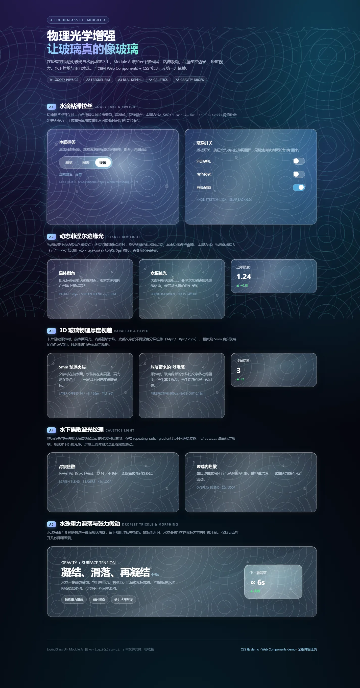

# LiquidGlass UI — Module A 实现与验证报告

> 对应需求：「一、核心升级清单 · 模块 A：视觉与物理光学效果增强」
> 版本：v0.2.0 ｜ 日期：2026-11-14 ｜ 实现位置：`wc/liquidglass-ui.js`（单文件、零依赖）

## 0. 交付物

| 文件 | 说明 |
|---|---|
| `wc/liquidglass-ui.js` | Module A 全部效果内置（CSS + 交互逻辑），仍为单文件零依赖 |
| `showcase.html` | Module A 演示页：A1–A5 逐项可交互演示 |
| `README.md` | 新增 Module A 能力表、结构、预览方式 |
| `package.json` | 版本 0.2.0，files 增加 showcase.html |
| `tools/audit-module-a.mjs` | 真实 Chrome（CDP）自动验收脚本 |
| `module-a-report.json` | 验收原始数据 |
| `shots/showcase-*.png` | 演示页截图（桌面 / 悬停 / goo 中间帧 / 移动端） |

本地预览：

```bash
npm start
# http://127.0.0.1:4173/showcase.html
```

## 1. 五项能力的实现方式

### A1 水滴粘滞拉丝（Gooey Tabs & Switch）

- **Tabs**：`<lg-tabs>` 的 Shadow DOM 内放一个 `.lg-tabs__goo` 层（内含主液滴 `blob` + 尾随液滴 `tail`），整层套 SVG goo 滤镜：
  `feGaussianBlur stdDeviation=6` → `feColorMatrix alpha 22x−9` 阈值化 → `feComposite atop`。
  `blob` 的 `left/width` 用 `cubic-bezier(0.34,1.56,0.64,1)` 缓动，`tail` 延迟 50ms 出发，两者先拉出"颈"再断丝融合。
- **Switch**：`.lg-switch__goo` 内同样有主球 + 尾球，切换时 `--sw-left` 从 2px ↔ 22px 变化；主球 0.42s、尾球 0.3s + 0.06s 延迟，形成拉丝；主球额外做 `scale(1.32,0.78)` 挤压回弹。
- 标签激活时液滴为白色高光，文字改为深色（`#07131f`）保证对比度；非激活标签文字保持白色。

### A2 动态菲涅尔边缘光（Fresnel Rim Light）

- 指针在玻璃上的位置写入 `--fx / --fy`（px）。
- 边缘层 `.lg-fresnel` 用 `mask-composite: exclude` 只保留 2px 描边，内部叠加两层径向渐变（白光 170px + 青色泛光 320px），`mix-blend-mode: screen`。
- 另有 `.lg-fresnel-glow` 做玻璃内部的柔和泛光，增强"光束掠边"的体积感。
- 仅 hover 时出现（`opacity 0 → 1`），无 JS 布局读写。

### A3 3D 玻璃物理厚度视差（Parallax & Depth）

- `.lg-tilt` 使用 `perspective(900px) rotateX/rotateY ±6°`。
- 指针归一化坐标写入 `--tx / --ty`（−1..1），各层按不同系数位移：
  - 文字 `translate(±14px)`
  - 水珠层 `translate(∓8px)`（反向，制造景深）
  - 高光 spotlight `±26px`
  - 菲涅尔光 `±20px`
- 形成"前表面文字 / 中间水珠 / 边缘高光"三层分离的 5mm 玻璃厚度感。

### A4 水下焦散波光纹理（Caustics）

- 页面级 `.caustics-bg`（showcase.html）：3 层 `repeating-radial-gradient` 以不同速度漂移，42s 循环，`screen` 混合，视口固定。
- 玻璃内 `.lg-caustics`（每张 `lg-card` / `lg-stat` 自动注入）：inset −25% 的细密光网，26s `lg-caustic-flow` 动画，`overlay` 混合，hover 时从 0.5 → 0.78 增强。

### A5 水珠重力滑落与张力微动（Droplet Trickle & Morphing）

- 每块玻璃每 3.6–7.8 秒随机挑一颗 `.lg-droplet`，用 WAAPI 播放约 1.9s 的"下滑 + 拉长 + 淡出"动画，同时生成 `.lg-wet-trail` 湿痕并渐隐删除。
- 指针移动时（rAF 节流）计算光标与每颗水珠的距离：90px 范围内水珠朝光标方向位移并 `scale(1.22, 0.86)` 挤压、`border-radius` 变形，离开后平滑恢复。

## 2. 浏览器验收结果

环境：Chrome 157.0.8103.78 Headless（真实渲染）＋ CDP 控制；视口 1440×900、390×844。
脚本：`node tools/audit-module-a.mjs`，结果见 `module-a-report.json`。

| 检查项 | 实测 | 结论 |
|---|---|---|
| 控制台 / 页面异常 / 资源错误 | 0（showcase / demo / wc-test / verify 四页） | ✅ |
| 15 个 Custom Elements 注册 | 15/15 | ✅ |
| Tabs goo 滤镜 | `url("#lg-tabs-goo-4")` | ✅ |
| Tabs 液滴定位 | 初始 left 1px/width 63px → 点击第 2 个后 left 68px | ✅ |
| Tabs 激活态 | `[true,false,false]` → `[false,true,false]`，日志同步 | ✅ |
| Tabs goo 中间帧 | 截图中可见 2→3 标签之间清晰的"拉丝颈"（`shots/showcase-goo.png`） | ✅ |
| Switch goo 滤镜 | `url("#lg-sw-goo-1")` | ✅ |
| Switch 切换 | `--sw-left: 22px → 2px`，动画类 `lg-switch--anim` 生效后自动移除 | ✅ |
| 菲涅尔边缘光 | hover 后 `opacity: 1`，`--fx: 288px / --fy: 149px` 随指针变化 | ✅ |
| 3D 倾斜 | `.lg-tilt` + `matrix3d(...)`（perspective 生效） | ✅ |
| 分层视差 | 文字 `translate(1.344, −2.982)`、水珠 `(−0.768, 1.704)`、高光 `(2.496, −5.538)`，方向/幅度各不相同 | ✅ |
| A4 页面焦散 | `animation: caustic-drift`，opacity 0.55 | ✅ |
| A4 玻璃焦散 | `animation: lg-caustic-flow`，每张卡均注入 | ✅ |
| A5 水珠滑落 | 自动检测到湿痕，5 条 trail | ✅ |
| 移动端 390px | `scrollWidth = 390`，无横向溢出 | ✅ |
| 回归：demo.html | 按钮 17、卡片 7、进度条 3，无报错 | ✅ |
| 回归：wc/test.html | 15 组件、雨滴 4/6/6、镜头高度 422、无报错 | ✅ |
| 回归：wc/verify.html | 标签激活/开关/进度条 API 正常，无报错 | ✅ |

### 顺手修复的两个历史 bug（被 Module A 演示页放大）

1. **`lg-lens` 高度塌陷**：`height="420"` 被拼成非法 CSS `height:420` → 内部高度 0。现在自动补 `px`，实测 lens 高度 **2px → 422px**，组件可见。
2. **`lg-lens` 参数面板飞出容器**：面板原本是 `.lg-lens` 的兄弟节点（挂在 ShadowRoot 下），`position:absolute` 以视口定位并压住 `lg-controls`。现在面板移入 `.lg-lens` 内部，实测 `panelParentClass: "lg-lens"`、`panelInsideLens: true`。
3. **组件重插异常**：所有组件 `connectedCallback` 增加 `if (this.shadowRoot) return;` 幂等保护，DOM 移动/重插不再抛 `NotSupportedError`（实测 `errors: []`，`stillUpgraded: true`）。

## 3. 截图

仓库内为压缩版 WebP（`docs/`），本地原始 PNG 在 `shots/`：

| 文件 | 内容 |
|---|---|
| `docs/showcase-desktop.webp` | 整页（桌面 1440px） |
| `docs/showcase-hover.webp` | 悬停态：菲涅尔掠边 + 3D 倾斜 |
| `docs/showcase-goo.webp` | Tabs 切换中间帧：液滴拉丝"颈" |
| `docs/showcase-mobile.webp` | 移动端 390px |



## 4. 复现

```bash
npm start
chrome --headless=new --remote-debugging-port=9333 --user-data-dir=%TEMP%\chrome-cdp about:blank
node tools/audit-module-a.mjs
```

## 5. 说明 / 边界

- Module A 能力实现在 **Web Components 版本**（`wc/liquidglass-ui.js`，即 npm `main` 入口）中；`demo.html` 的纯 CSS 用法仍保持基础组件（若需要，可把 A2–A5 抽成可选的 light-DOM 增强脚本）。
- 需求原文在 A5 "鼠标悬浮时水滴产生受力挤压形" 处截断。如后续还有模块 B / C，请继续发我，我会按同样方式（实现 → Chrome 自动验收 → 截图）推进。
