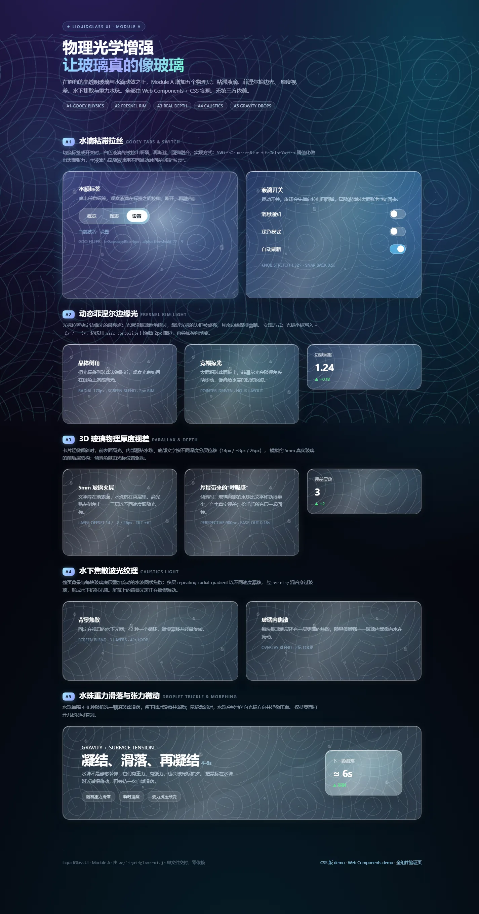

# LiquidGlass UI

> **版本说明**：`main` 分支为原版（v0.1）；`plus` 分支在原版基础上加入 Module A 物理光学增强与四项链底层性能优化（v0.3），本 README 描述 plus 版本。

**水感液态玻璃组件库** — 高透明玻璃 + 彩色泛光 + 水滴动效。

## 定位

区别于中性克制的 Apple Liquid Glass，LiquidGlass UI 主打**有机的"水感"**：

- **玻璃材质**：高透明 + 青色/紫色彩色泛光，非灰白中性
- **水感动效**：凝结水珠、流光、弹跳缓动作为组件签名交互
- **场景**：数据面板、汇报页、产品演示、动效展示

## Module A：物理光学增强（v0.2）

在基础玻璃之上，新增 5 个"物理层"，让玻璃具有真实的光学与力学质感：

| 编号 | 能力 | 实现与效果 |
|---|---|---|
| A1 | 水滴粘滞拉丝 | `lg-tabs` / `lg-switch` 切换时，液滴先拉伸成"颈"、断丝、再融合；SVG `feGaussianBlur + feColorMatrix` 做表面张力，主液滴与尾随液滴用缓动时间差制造拉丝 |
| A2 | 动态菲涅尔边缘光 | 光标坐标写入 `--fx / --fy`，用 `mask-composite` 只保留 2px 描边，再叠加径向渐变与内侧泛光：光束沿玻璃倒角掠过 |
| A3 | 3D 玻璃物理厚度视差 | 卡片悬浮时轻微倾斜；前表面高光、内部水珠、文字按不同深度（−8px / 14px / 26px）分层位移，模拟约 5mm 玻璃厚度 |
| A4 | 水下焦散波光纹理 | 页面背景与每块玻璃底层叠加多层流动焦散光网（`overlay` / `screen` 混合），形成水下折射光感 |
| A5 | 水珠重力滑落与张力微动 | 水珠每 4–8 秒随机沿玻璃滑落并留下瞬时湿痕；光标靠近时水珠朝光标方向挤压形变 |

预览 Module A：`npm start` 后打开 <http://127.0.0.1:4173/showcase.html>。



## 性能架构（v0.3）

在 Module A 之上做的四项底层优化，分别对应字符串重复编译、Layout/Paint 抖动、sRGB 渐变发灰、全局脏检查四类瓶颈：

| 优化 | 瓶颈 | 实现 | 实测（Chrome 157 / 1440×900） |
|---|---|---|---|
| 1. 样式表共享 | 每个组件实例重复编译 ~33KB CSS，内存与挂载成本随实例数线性增长 | 所有 Shadow Root 通过 `adoptedStyleSheets` 复用同一份 `CSSStyleSheet`（`lg-lens` 额外一份专有表）；不支持 Constructable Stylesheets 时自动回退 `<style>` | 19 个 shadow root 共享 1 份 CSSOM；每实例样式字节 **0**（优化前 15 个实例约 494KB）；60 张卡片挂载约 **1.2ms** |
| 2. GPU 合成驱动 | `background-position` / `top` 等动画触发 Layout 与逐像素重绘 | 场景、流光、焦散、雨滴、镜头扫光全部改为 `transform`；Tabs/Switch 位移改 `translate3d`；活动层 `will-change` / `backface-visibility` | 2 秒动画窗口 **LayoutCount = 0**；所有关键帧属性仅 `transform` / `opacity` |
| 3. oklch 色彩 | sRGB 渐变中段发灰、变脏 | 设计令牌与场景/按钮/进度/徽章/标签渐变全部改用 oklch，渐变用 `in oklch` 插值，保持恒定明度 | 计算样式确认 `oklch(...)` 与 `linear-gradient(... in oklch ...)` 生效，水感更纯净 |
| 4. contain 隔离 | 全局布局/绘制/样式脏检查互相牵连 | `.lg-glass` 使用 `contain: layout paint style`（计算值 `content`）；tabs / rain / grating / controls / lens 各自隔离 | 复杂动效互不干扰，长页面滚动布局稳定 |

验证脚本：`node tools/audit-perf.mjs`（Chrome CDP + 零依赖），输出 `perf-report.json`。

## 结构

```
LiquidGlass-UI/
├── tokens.css      # 设计令牌（颜色/玻璃/圆角/动效曲线）
├── glass.css       # 玻璃基础材质（场景背景/玻璃面板/水珠层）
├── components.css  # 15 个组件样式
├── demo.html       # 统一演示页（全部组件 + 交互）
├── showcase.html   # Module A 物理光学增强演示页
├── serve.mjs       # 零依赖本地预览服务器（npm start）
├── package.json    # npm 发布元数据
├── tools/          # 浏览器验证脚本（CDP，零依赖）
└── wc/             # Web Components 封装
    ├── liquidglass-ui.js  # 原生 Custom Elements（单文件、零依赖）
    ├── test.html          # Web Components 演示页（雨滴/光栅/镜头/控制面板）
    ├── verify.html        # 全 15 个组件的验证页
    └── isolated.html      # 无外部 CSS 的隔离测试页
```

## 组件清单

| 类别 | 组件 |
|---|---|
| 导航 | Navbar |
| 按钮 | Button（primary/success/warning/danger/ghost，sm/lg/block） |
| 表单 | Input、Select、Checkbox、Radio、Switch、Slider |
| 数据 | Stat 指标卡、Progress 进度条 |
| 导航 | Tabs 标签页 |
| 反馈 | Badge 徽章、Toast 提示、Dropdown 下拉 |
| 容器 | Card、Glass 玻璃面板 |
| 增强层 | Rain 雨滴、Grating 光栅、Controls 控制面板、Lens 镜头玻璃 |

## 本地预览

```bash
npm start                 # 等价 node serve.mjs，默认 127.0.0.1:4173
# demo.html / showcase.html / wc/test.html / wc/verify.html
```

## 使用（CSS 方式）

```html
<link rel="stylesheet" href="tokens.css">
<link rel="stylesheet" href="glass.css">
<link rel="stylesheet" href="components.css">
```

```html
<button class="lg-btn lg-btn--primary">主要按钮</button>
```

## Web Components（原生封装）

无需框架，引入单个 JS 即可使用 `<lg-*>` 标签：

```html
<script src="wc/liquidglass-ui.js"></script>

<lg-button variant="primary">主要按钮</lg-button>
<lg-card>...</lg-card>
<lg-input placeholder="姓名"></lg-input>
<lg-stat label="营收" value="¥86.2万" delta="+8.3%" trend="up"></lg-stat>
<lg-progress value="82" size="lg"></lg-progress>
<lg-switch checked>消息通知</lg-switch>
<lg-badge variant="success">已通过</lg-badge>
<lg-tabs><lg-tab>概览</lg-tab><lg-tab>图表</lg-tab></lg-tabs>
<lg-toast type="success">操作成功</lg-toast>
```

组件清单：`lg-button` `lg-card` `lg-input` `lg-select` `lg-switch`
`lg-badge` `lg-stat` `lg-progress` `lg-tabs` `lg-tab` `lg-toast`
`lg-rain` `lg-grating` `lg-controls` `lg-lens`

特性：Shadow DOM 隔离、属性驱动、`lg-click`/`lg-toggle`/`lg-input` 等事件透传、零依赖；
Module A 的 goo 滤镜、菲涅尔边缘光、厚度视差、焦散与水珠滑落均内置在单文件中，无需额外依赖。
预览：打开 `wc/test.html` 或 `showcase.html`；API 见 `window.LiquidGlassUI`。

## 在线演示

- Pages：https://idhdi.github.io/LiquidGlass-UI/
- 仓库：https://github.com/idhdi/LiquidGlass-UI

## 后续路线

- [x] 组件拆包发布（npm + Web Component）
- [x] Module A 物理光学增强（Gooey / Fresnel / Depth / Caustics / Droplet）
- [ ] 参数化调参生成器（可视化导出代码）
- [ ] AI Skill 技能包（SKILL.md + 组件 JSON 元数据）
